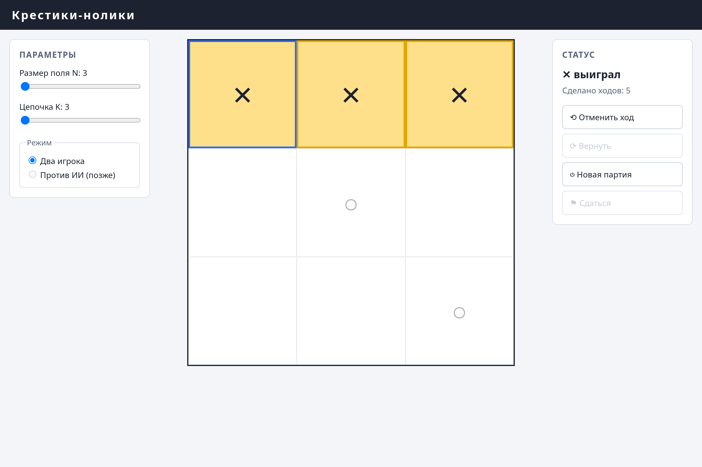

# Крестики-нолики N x N

Браузерная игра в крестики-нолики на поле настраиваемого размера с настраиваемой
длиной победной цепочки. Чистые HTML, CSS и JavaScript на ES-модулях, без сборщика.
Единственная зависимость это `express`, она нужна серверу для режима "По сети".

## Команды

Запуск вместе с сервером:

```
npm install
npm start
```

Открыть http://localhost:3000/ в браузере. Порт можно поменять переменной окружения
`PORT`. Сервер отдаёт и страницу, и API, а база лежит в файле `server/ttt.db`, он
создаётся при первом запуске.

Запуск без сервера, только для локальных режимов ("Два игрока" и "Против ИИ"):

```
python -m http.server 8000
```

Открыть http://localhost:8000/ в браузере. Режим "По сети" без сервера не работает,
он пишет "Сервер недоступен".

Тесты:

```
npm test
```

То же самое делает `node --test`.

## Возможности

- **Поле N x N, N от 3 до 15**, победная цепочка **K от 3 до N**. Оба параметра
  задаются ползунками; их смена начинает новую партию (если ходы уже сделаны,
  сначала спросит).
- **Режим "два игрока"** на одном устройстве. Крестик всегда ходит первым.
- **Ход мышью и клавиатурой**: стрелки или `hjkl` двигают курсор, `Enter` и пробел
  ставят камень. По занятой клетке сходить нельзя, после конца партии тоже нельзя.
- **Автоматическое определение результата**: победа по сплошной цепочке из K и более
  камней или ничья. Выигрышная линия подсвечивается, остальные камни приглушаются.
- **Управление партией**: отмена и возврат ходов (кнопки гаснут, когда стек пуст),
  сдача, новая партия.
- **Сохранение**: партия, стек возврата и настройки переживают перезагрузку страницы.
  Испорченная запись в `localStorage` не ломает игру, она начинается с чистой доски.
- **Режим "По сети"** (нужен сервер): регистрация и вход по паролю, никнейм уникален.
  Играть можно со случайным соперником, который выбрал те же N и K, или с другом по
  пригласительной ссылке. Общий рейтинг: победа даёт 3 очка, ничья 1. В "Моих партиях"
  видны статистика, список партий с цветной меткой результата и повтор любой
  законченной партии ход за ходом.

## Как устроено

Код разделён на слои, и зависимости идут только вниз: значения клетки и координаты,
правила победы и ходов-кандидатов, модель партии, сохранение, отрисовка и точка входа.
Слои логики не обращаются к `document`, `window` и `localStorage`, поэтому покрыты
тестами и работают в Node без браузера.

ИИ выбирает ход перебором alpha-beta: лёгкий уровень смотрит на 1 полуход вперёд,
средний на 2, сложный на 3 или 4. Позицию на пределе глубины оценивает эвристика:
сумма по всем отрезкам длины K, где ещё можно собрать цепочку.

Режим "По сети" держится на сервере. Express отдаёт страницу и REST API, данные лежат
в SQLite (встроенный модуль `node:sqlite`). Ходы проверяет тот же `js/game.js`, что и
в браузере, поэтому правила игры остаются в одном месте. Вход работает через токен:
пароль хранится как соль и хеш, а токен браузер присылает в заголовке `Authorization`.
У сервера нет WebSocket, ход соперника браузер узнаёт опросом раз в секунду.
Сервер лежит в `server/`, а запросы к нему в `js/net.js`.

Адреса API, тело запроса и ответа в JSON:

| Адрес | Что делает |
|---|---|
| `POST /register` | регистрация, выдаёт токен |
| `POST /login` | вход, выдаёт новый токен |
| `POST /logout` | выход, токен перестаёт работать |
| `GET /leaderboard` | рейтинг, 20 лучших игроков |
| `GET /profile` | статистика игрока и его 20 последних партий |
| `POST /games` | новая партия: случайный соперник или приглашение |
| `POST /games/:id/join` | вход в партию по пригласительной ссылке |
| `GET /games/:id` | состояние партии, его браузер спрашивает раз в секунду |
| `POST /games/:id/move` | ход `{cell}` или сдача `{resign: true}` |


