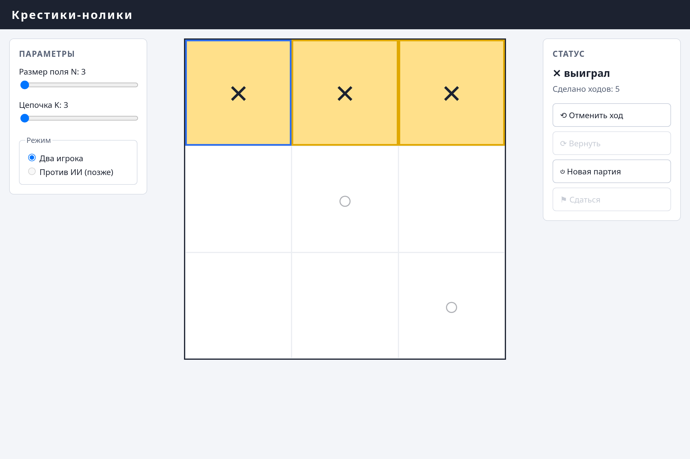

# Крестики-нолики N x N

Браузерная игра в крестики-нолики на поле настраиваемого размера с настраиваемой
длиной победной цепочки. Чистые HTML, CSS и JavaScript на ES-модулях: ни сборщика,
ни зависимостей, ни `npm install`.

## Команды

Из каталога `src`.

Запуск:

```
python -m http.server 8000
```

Открыть http://localhost:8000/ в браузере.

Тесты:

```
node --test
```

## Возможности

- **Поле N x N, N от 3 до 15**, победная цепочка **K от 3 до N**. Оба параметра
  задаются ползунками; их смена начинает новую партию (если ходы уже сделаны,
  сначала спросит).
- **Режим "два игрока"** на одном устройстве. Крестик всегда ходит первым.
- **Ход мышью и клавиатурой**: стрелки или `hjkl` двигают курсор, `Enter` и пробел
  ставят камень. По занятой клетке сходить нельзя, после конца партии тоже нельзя.
- **Автоматическое определение результата**: победа по сплошной цепочке из K и более
  камней или ничья. Выигрышная линия подсвечивается, остальные камни приглушаются.
- **Управление партией**: отмена и возврат ходов (кнопки гаснут, когда стек пуст),
  сдача, новая партия.

## Как устроено

Код разделён на слои, и зависимости идут только вниз: значения клетки и координаты,
правила победы и ходов-кандидатов, модель партии, отрисовка и точка входа.
Слои логики не обращаются к `document`, `window` и `localStorage`, поэтому покрыты
тестами и работают в Node без браузера.

## Что ещё не подключено

- соперник-ИИ: режим, сложность и генератор ходов-кандидатов уже заложены в модель,
  сам поиск хода пока нет;
- сохранение партии между перезагрузками страницы;
- счётчик побед и поражений.


